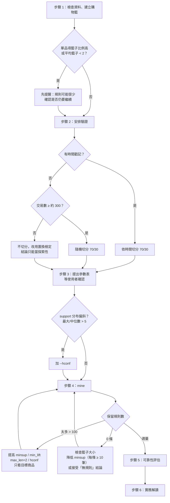

# 關聯規則分析決策樹

本檔是 SKILL.md 工作流程的細部版本。每一步都要**先回報輸出、取得同意，才進入下一步**。

## 步驟 1：檢查資料並建立購物籃

| 節點 | 問題 | 處理 |
|---|---|---|
| 欄位角色 | 哪一欄是交易編號、品項、時間、數量？ | 腳本會自動偵測常見欄名；偵測不到時用 `--tid-col` / `--item-col` 等參數指定 |
| 資料格式 | 一列一品項、一列一籃，還是 0/1 矩陣？ | `--format long / basket / wide`；basket 格式用 `--sep` 指定分隔符號 |
| 缺漏 | 交易編號或品名空白？ | 移除，並記錄列數 |
| 品名不一致 | 大小寫、前後空白不同 | 去空白、轉小寫後合併，並記錄 |
| 數量 ≤ 0 | 退貨、取消（例如發票編號以 C 開頭）| 移除，並記錄。若使用者想把退貨抵銷原購買，另外討論 |
| 同籃重複品項 | 同一交易同一品項多列 | 合併為一次（二元化） |
| 交易定義 | 同一顧客一天內多張發票算一籃嗎？ | 這是**業務問題**，詢問使用者；預設以交易編號為準 |

**輸出**：清理紀錄、交易數 N、商品數、籃子大小分布、商品頻率（前 / 後段）、support 分位數。

## 步驟 2：先安排驗證，再開始探勘

| 情況 | 建議 | 可支持的結論 |
|---|---|---|
| 有時間戳記 | 依時間切分：前 70% 探勘、後 30% 驗證 | 「規則在後續期間仍成立」，最接近實際使用情境 |
| 無時間戳記、N ≥ 約 300 | 隨機切分 70/30（固定 seed） | 「規則不是這批樣本的偶然」，但不保證未來穩定 |
| N 小 | 不切分；用置換檢定 + Fisher exact + FDR | 只能當探索性假說 |
| 多門市 / 多通路 | 切分外，再用 `stratify --by store` 檢查 | 「規則在各門市方向一致」 |

**輸出**：切分方式、理由、兩邊交易數、可支持的結論範圍。

## 步驟 3：設定門檻與演算法

腳本 profile 會依資料提出建議（寬鬆 / 標準 / 嚴格），使用者可以全部覆寫。

| 參數 | 角色 | 標準建議 | 理由 |
|---|---|---|---|
| min_support | 探勘門檻（anti-monotone，用來剪枝） | max(10/N, 2×中位數 support²) | 兩個中位數頻率商品在 lift≈2 時仍可被找到，且每條規則至少約 10 筆交易 |
| min_confidence | 規則門檻 | 0.3 | confidence 沒考慮後項本身的普及度，不宜當主要篩選 |
| min_lift | **事後篩選**，不是探勘門檻 | 1.0–1.2 | lift > 1 表示比獨立時更常一起出現 |
| max_len | 規則總品項數 | 3 | 可讀性，也減少巧合 |
| hconf | cross-support 篩選 | 偏斜時 0.05 | 去除高頻商品（如牛奶）硬湊的規則（5.8） |
| 演算法 | 計算方式 | FP-growth | 與 Apriori 結果相同，只差速度 |

**輸出**：參數表（建議值、理由、使用者最終決定）。

## 步驟 4：產生規則

| 情境 | 判斷 | 處理順序 |
|---|---|---|
| 太多 | 保留 > 約 100 條 | 1. min_lift 提高到 1.5；2. max_len=2；3. 加 hconf；4. 提高 minsup；5. 只看含目標商品的規則 |
| 沒有 | 保留 0 條 | 1. 檢查單品項籃子比例；2. minsup 減半（每條規則 ≥ 10 筆）；3. 降 confidence；4. 接受「沒有規則」的結論 |
| 成對規則 | A→B 與 B→A 都在 | lift 相同；依 confidence 決定哪個方向較有行動意義，報告時合併 |
| 冗餘 | {A,C}→B 的 confidence 不比 A→B 高 | 腳本預設移除；`--keep-redundant` 可保留 |

**輸出**：frequent itemset 數（含 closed / maximal）、候選規則表、被排除規則與原因
（`excluded_rules.csv`）。

## 步驟 5：評估可靠性

| 檢查 | 何時做 | 判讀 |
|---|---|---|
| 驗證集重現（validate） | 有切分時一定做 | test_lift > 1 且 BH q < 0.05 → ✅ |
| Fisher exact + BH-FDR | 同上（在驗證集上算） | 單尾檢定正相關；多條規則一起校正 |
| 置換檢定（permtest） | 沒有切分、或想知道「巧合規則」有多少 | 虛無平均規則數 / 觀察規則數 ≈ 規則中純屬巧合的比例 |
| 分層（stratify） | 有門市、時段等可能的干擾變數 | 各層方向與合併資料相反 → Simpson's paradox，不可直接使用 |
| null-invariant 指標 | 規則涉及稀有商品 | lift 很高但 kulczynski / cosine 很低 → 關聯只占少數交易，慎用 |

**輸出**：每條規則的可靠性分級（✅ / ⚠️ / ❌）與整體重現率。

## 步驟 6：實務解讀

> 規則 = 共同出現，不等於因果。行動建議需要再用實驗（例如促銷 A/B 測試）確認效果。

| 欄位 | 內容 |
|---|---|
| 規則 | {A} → {B} |
| 白話 | 買 A 的顧客中 X% 也買 B，是整體顧客購買 B 比例的 L 倍 |
| 影響範圍 | support = 每 100 筆交易中約 s 筆同時有 A 和 B |
| 可靠性 | ✅ / ⚠️ / ❌ 與依據 |
| 建議行動 | 陳列相鄰、組合價、結帳推薦…… |
| 限制 | 期間、門市、是否為顯而易見的規則、因果未確認 |
