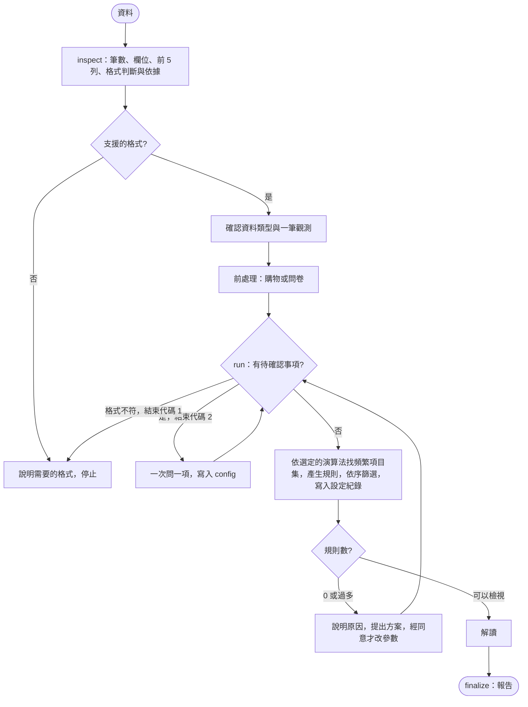

# 流程、規則與停止條件

本檔是 `scripts/run_arules.py` 實際執行的規則，與分析指南 `docs/skill-guide.html` 第 8 章一致。
流程圖（整體、購物前處理、問卷前處理）與完整的操作規格表在指南第 8 章；這裡列出實作時要查的細節。

## 1. 流程

## 2. 格式判斷（inspect）

判斷看資料結構，欄位名稱只當輔助線索；結果只是**提議**，要經使用者確認。使用者已經說明時直接沿用。

| 順序 | 結構特徵 | 判斷 |
|:--|:--|:--|
| 1 | ≥ 2 欄只有 0/1，其他欄最多一欄且每列不同 | 0/1 矩陣：要問 0/1 是「有買／沒買」還是問卷「否／是」 |
| 2 | ≤ 3 欄，某文字欄 ≥ 50% 的列含分隔符號 | 購物清單（一列一筆） |
| 3 | 2–6 欄；某欄值重複（不同值占 1%–67%）；同一個值底下平均 ≥ 1.5 個不同項目，且各列項目幾乎都不同（≥ 80%）；項目欄不是每列都不同 | 交易明細長表。項目有 ≥ 90% 寫成「欄位=類別」時，是已編碼的問卷 |
| 4 | 其他、≥ 2 欄 | 類別問卷寬表 |

問卷欄位的初步角色：

| 條件 | 角色 | 處理 |
|:--|:--|:--|
| 不同值 ≥ 20 種且占 ≥ 95%，或名稱像編號且占 ≥ 90% | ID | 不納入規則 |
| 名稱像權重且是數字 | 權重 | 不納入；結果為未加權樣本描述 |
| ≥ 80% 是數字、≤ 10 種整數值 | 可能是類別代碼 | 需要資料字典，或使用者確認數字就是答案 |
| ≥ 80% 是數字、其他情況 | 未分組數值 | 第一版不支援：改用已分組欄位或不選 |
| 平均長度 > 20 且多數答案不同 | 開放題 | 不納入 |
| 其他 | 類別 | 預設列入分析欄位 |

## 3. 前處理

### 3.1 購物資料

| 規則 | 類型 | 停止條件 |
|:--|:--|:--|
| 確認交易 ID 的意義，填 `unit` | 詢問 | — |
| 購物清單以分隔符號拆開；0/1 矩陣取值為 1 的欄名 | 自動 | 0/1 矩陣有空白或其他值 |
| 交易 ID 空白 | 詢問（建議排除該列；不猜測屬於哪一筆交易） | — |
| 去除商品名稱前後空白 | 自動，記錄列數 | — |
| 空白的商品名稱 | 詢問（建議排除該列） | — |
| 疑似同義名稱（只差大小寫、全形半形、空白） | 詢問；確認才合併 | — |
| 數量 ≤ 0 或不是數字 | 詢問 | — |
| 同一交易同商品只算一次 | 自動，記錄列數 | — |
| 空的交易 | 詢問（排除或保留在分母） | — |
| 只有一種商品的交易、內容相同的不同交易 | 自動保留，記錄筆數 | — |
| 數量、金額不成為項目；不產生「未購買」項目 | 自動 | — |

### 3.2 類別問卷

| 規則 | 類型 | 停止條件 |
|:--|:--|:--|
| 依資料字典解碼；類別為「缺失」的值與空白設為缺失 | 依字典 | 有資料字典沒有的值 |
| 沒有資料字典的數字欄位 | 詢問：提供說明或確認數字就是答案 | 無法說明 |
| 未分組數值欄位 | — | 第一版不自動分箱 |
| ID、權重、開放題不成為項目 | 自動，列出原因 | — |
| 分析欄位 | 詢問 | 未選擇 |
| 完整案例分析：只看選定欄位，任一缺失者排除 | 詢問：告知排除與剩下人數、可能偏誤 | 使用者不同意 |
| 每人一個 basket；項目為「欄位=類別」；「否」也是項目；序位變數當類別 | 自動 | — |
| 答案相同的受訪者都保留；不合併類別 | 自動 | — |
| 「欄位=類別」長表先還原成寬表 | 自動 | 同一人同一欄有多個答案（複選題） |

## 4. 分析目標與參數

| 目標 | `question.goal` | 規則形式 |
|:--|:--|:--|
| 自由探索 | `free` | 前件 ≤ `max_lhs` 項、後件 1 項 |
| 指定前件 | `lhs` | 前件 = `items`（全部）、後件 1 項 |
| 指定後件 | `rhs` | 後件 = `items`（1 項）、前件 ≤ `max_lhs` 項 |

**示範設定**（`run` 在參數未確認時列出；只是起點，**不是通用標準**）：

| 參數 | 示範值 | 理由 | 限制 |
|:--|:--|:--|:--|
| 演算法 | FP-growth（使用者可改 Apriori） | 兩者找到的頻繁項目集完全相同；FP-growth 通常較快 | 指定前件時直接計數，演算法不影響結果 |
| 最低支持度 | 1%，但至少 2 筆；一律同時列出對應最低筆數 ⌈minsup × N⌉ | 避免只出現一兩次的巧合組合 | 會排除低頻但有意義的組合 |
| confidence | 0.3 | 只排除很弱的規則 | 不考慮後件本來多常見，要對照後件比例 |
| lift | > 1 | 只留正相關 | 不代表顯著 |
| 前件長度 | ≤ 2 項 | 容易解讀 | 漏掉較長的組合 |
| 最低前件筆數 | 等於最低共同筆數 | 避免「1 筆中 1 筆」的 confidence | 本身也是主觀選擇 |

程式同時列出「只改最低支持度」與「只改 confidence」時的規則數，協助使用者決定，不自動選擇。

## 5. 頻繁項目集與篩選順序（固定）

頻繁項目集依 `params.algorithm` 計算：`apriori`（逐層產生候選、用 Apriori 原理剪枝）或 `fpgrowth`（FP-tree 分治）。
兩者結果相同，只差速度；指定前件時直接計數包含前件的交易，不需要找全部頻繁項目集。

1. 共同筆數 ≥ ⌈minsup × N⌉
2. 前件筆數 ≥ `min_lhs_count`
3. confidence ≥ `min_confidence`
4. lift > `min_lift`
5. 移除冗餘規則：前件拿掉任一項後（同一後件）confidence 已相同或更高（指定前件時不適用）

問卷中，若欄位間有函數關係（每個值至少 5 人），規則會加註「定義上必然成立，不是新發現」，不刪除。
排序：lift 由高到低，同分再依共同筆數。

## 6. 設定紀錄

每次 `run` 把目標、設定（含對應筆數）、保留規則數、理由寫入 `settings_log.json`，報告第 3 章列出全部紀錄。
沒有規則或規則過多時，只能在說明原因並經使用者同意後修改 `params`，不得為了產生漂亮結果而調整門檻。

## 7. 結果的性質

第一版不做保留資料驗證，也不做統計檢定。結果是對這份資料的描述，屬探索性；報告要註明這點，
不能寫「顯著」。

## 8. 出處

流程與規則以分析指南第 8 章為準。相關概念見 Tan, Steinbach, Karpatne & Kumar (2019)：
Apriori 原理與演算法在 5.2 節；規則產生與 confidence 剪枝在 5.3 節；FP-growth 在 5.6 節；
類別屬性轉成項目在 6.1 節。章節對照表見指南第 9 章最後。
