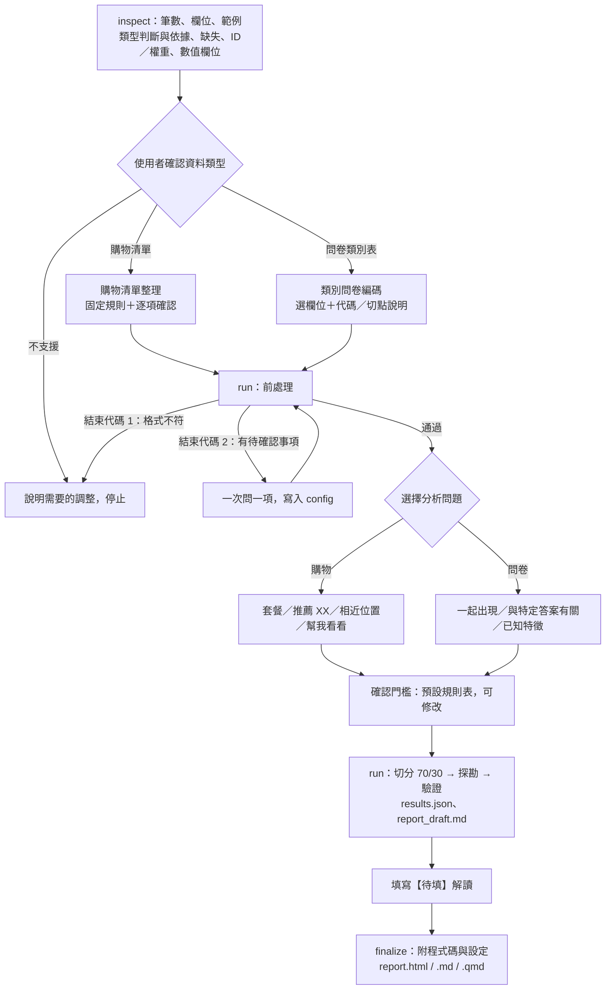

# 流程、固定規則與門檻

本檔列出 `scripts/run_arules.py` 實際執行的規則。同一份資料與同一份 config，每次都會得到相同結果；
需要使用者決定的地方都明確列出，其他一律照固定規則。

## 1. 流程

## 2. 資料類型判斷（inspect）

判斷看資料結構，欄位名稱只當輔助依據。判斷結果只是**提議**，一定要經使用者確認；使用者已經說明時直接沿用。

| 順序 | 結構特徵 | 判斷 |
|:--|:--|:--|
| 1 | ≥ 2 欄只有 0/1（或 TRUE/FALSE），其他欄最多一欄、且每列不同 | 已完成的項目集合（0/1 矩陣）。要問 0/1 是「有買／沒買」還是問卷「是／否」 |
| 2 | ≤ 3 欄，其中一個文字欄有 ≥ 50% 的列含分隔符號（`,` `;` `\|` `、`） | 購物清單：購物籃格式 |
| 3 | 2–6 欄；某欄的值會重複（不同值占 1%–67%），且每個值平均對應 ≥ 1.5 個另一文字欄的不同值 | 購物清單：長格式。若項目有 ≥ 90% 寫成「欄位=答案」，就是已完成的問卷項目 |
| 4 | 其他、≥ 2 欄 | 問卷類別表（一列一個觀測單位） |
| 5 | 只有 1 欄 | 不支援 |

問卷欄位的初步角色（同樣要確認）：

| 條件 | 角色 | 處理 |
|:--|:--|:--|
| 不同值 ≥ 20 種且占 ≥ 95% | 可能是 ID | 不當成項目 |
| 名稱像權重且內容是數字 | 可能是權重 | 不當成項目；報告註明未加權 |
| ≥ 80% 是數字、≤ 10 種值、都是整數 | 數字代碼？ | 需要編碼表，或使用者確認數字本身就是答案 |
| ≥ 80% 是數字、其他情況 | 數值 | 不支援；使用者提供切點，或不選這一欄 |
| 平均長度 > 20 且多數答案都不同 | 開放文字 | 不當成項目 |
| 其他 | 類別 | 預設列入分析欄位 |

另外會提醒：可能代表缺失的字串（`NA`、`99` 以外的文字如「拒答」「不知道」等）、前後空白、完全相同的列（不刪除）、
占比 ≥ 80% 的答案（當後件時 lift 多半接近 1）。

## 3. 前處理

### 3.1 購物清單整理

| 項目 | 規則 | 要不要問 |
|:--|:--|:--|
| 格式轉換 | 購物籃格式以分隔符號拆開；0/1 矩陣取值為 1 的欄名 | 不問（記錄列數） |
| 前後空白 | 去除商品名稱前後空白 | 不問（記錄列數） |
| 同一張訂單重複的商品 | 記為一次（關聯規則只看「有沒有買」） | 不問（記錄列數） |
| 疑似同義名稱 | 只差大小寫、全形半形或空白的名稱列出來 | **問**；使用者確認為同一商品的才寫入 `item_aliases` |
| 商品值缺失 | 建議排除該列；不能當成沒買 | **問** |
| 空的訂單 | 排除，或保留在總訂單數（會讓 support 變小） | **問** |
| 數量 ≤ 0 或不是數字 | 排除或保留 | **問**（有數量欄時） |
| 訂單編號缺失 | 無法判斷屬於哪一張訂單 | 格式問題：請使用者補資料 |
| 0/1 矩陣有空白或其他值 | 不能當成 0 | 格式問題：請使用者補資料 |
| 內容相同的不同訂單 | 全部保留 | 不問 |

### 3.2 類別問卷編碼

| 項目 | 規則 |
|:--|:--|
| 項目 | 「原欄位名稱=原答案」，不改名、不合併答案 |
| 分析欄位 | 使用者選擇；ID、權重、開放文字、未選的欄位都記錄原因 |
| 缺失 | 空白一律是缺失；使用者說明的代碼（拒答、不知道、不適用）也當成缺失。不當成「否」，也不產生項目 |
| 完整個案分析 | 選定欄位任一缺失的列排除。執行前列出排除與剩下的筆數，使用者同意後才繼續 |
| 數字代碼 | 有編碼表就換成標籤；使用者確認「數字就是答案」就照原值；兩者都沒有就停止 |
| 數值欄位 | 只用使用者提供的切點（`pd.cut`，預設左閉右開）；值落在切點外就停止，請使用者調整 |
| 相同的列 | 全部保留 |
| 「欄位=答案」長格式 | 先還原成一列一位受訪者；同一人同一欄有多個答案（複選題）時停止，請使用者先拆成每個選項一欄 |

## 4. 分析問題、規則形式與預設門檻

N 是探勘資料的觀測單位數（切出驗證資料後的 70%）。

| 問題 | 代碼 | 規則形式與篩選 | 排序 | 最低共同出現筆數 | confidence | lift |
|:--|:--|:--|:--|:--|:--|:--|
| 哪些商品適合組成套餐？ | `bundle` | 2–3 項的頻繁項目集；組合中每一項和其餘項目的 lift 都 > 1 | 共同出現筆數 | max(10, ⌈0.5% N⌉) | 不設 | > 1 |
| 買 XX 的人可以推薦什麼？ | `recommend` | 前件 = {XX}，後件 1 項 | lift，再看 confidence | max(10, ⌈0.5% N⌉) | ≥ 0.1 | > 1 |
| 哪些商品可以放在相近位置？ | `placement` | 2 項組合（雙向） | lift；附 cosine、Kulczynski | max(10, ⌈0.5% N⌉) | 不設 | > 1 |
| 幫我看看 | `explore` | 前件 ≤ 2、後件 1；移除冗餘規則 | lift | max(10, ⌈0.5% N⌉) | ≥ 0.1 | > 1 |
| 哪些回答常一起出現？ | `cooccur` | 前件 ≤ 2 個答案、後件 1 個；移除冗餘、定義性規則 | lift | max(10, ⌈5% N⌉) | ≥ 0.5 | > 1 |
| 哪些條件與特定答案有關？ | `target` | 後件 = 指定答案、前件 ≤ 2 個其他欄位的答案；移除冗餘、定義性規則 | lift | max(10, ⌈1% N⌉) | 不設 | > 1 |
| 已知某種特徵，還有哪些答案常見？ | `given` | 前件 = 指定特徵、後件 1 個其他欄位的答案 | confidence；附基準比例與 lift | max(10, ⌈1% N⌉) | 不設 | 不設；lift ≤ 1 另外標示 |

- **冗餘規則**：前件有 2 項的規則，只要其中一項單獨當前件時的 confidence 已經相同或更高，就移除。
- **定義性規則**（問卷）：欄位 X 的每個答案只對應欄位 Y 的一個答案（每個值至少 5 人），例如「縣市 → 區域」。
  這類規則一定成立，不是發現，所以移除，並在篩選過程表列出。
- confidence = 1 的規則保留，但加註「請確認是否定義上必然」。
- 報告表格只列前 20 筆，完整結果在 `results_full.csv`。
- **沒有結果時**：只提一個選項，請使用者決定要不要把最低共同出現筆數降到 10 再跑一次。
- 使用者修改的門檻寫入 `params`，報告會標示「使用者調整」。

## 5. 驗證（固定步驟）

| 條件 | 做法 |
|:--|:--|
| 觀測單位 < 300 | 不切分，結果全部視為探索性（報告註明） |
| 每筆訂單都有可解析的時間 | 依時間排序：最早 70% 探勘、最晚 30% 驗證 |
| 其他 | 隨機切分 70/30（seed = 2026） |

在驗證資料上，每筆結果做單尾 Fisher exact test（H0：獨立；H1：正相關），全部檢定一起做 Benjamini–Hochberg
校正。「重現」的定義是驗證資料 lift > 1 且 q < 0.05。

- 套餐（3 項）：組合中每一項對其餘項目分別檢定，取最大的 p 值（每個方向都要成立）。
- `given` 中 lift ≤ 1 的結果不檢驗。

使用者明確說不要驗證時，把 `validation.enabled` 設為 false，報告會註明結果是探索性的。

## 6. 不支援的情況

遇到以下情況時，說明需要的調整並停止，不自行處理：

- 複選題（同一人同一欄有多個答案）
- 需要加權的分析（只能做未加權的樣本描述）
- 序列、時間順序的樣式（sequential patterns）
- 同時有多個觀測單位層級（例如顧客 × 訂單），而使用者沒有說明以哪一層為準
