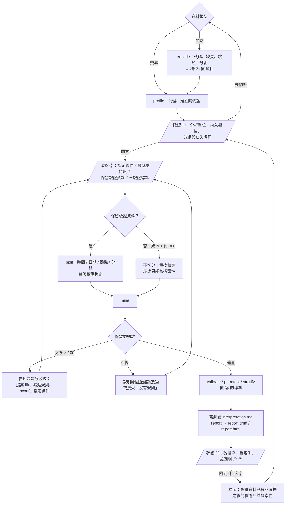

# 關聯規則分析決策樹

本檔是 SKILL.md 工作流程的細部版本。對使用者只有**三次確認**（① 資料設定、② 探勘與驗證設定、
③ 結果檢視），確認之間自動執行。選項表與訊息範本見 `options.md`。

## 步驟 1：檢查資料並建立項目集合（確認 ①）

### 交易資料

| 節點 | 問題 | 處理 |
|---|---|---|
| 欄位角色 | 哪一欄是交易編號、品項、時間、數量？ | 腳本會自動偵測常見欄名；偵測不到時用 `--tid-col` / `--item-col` 等參數指定 |
| 資料格式 | 一列一品項、一列一籃，還是 0/1 矩陣？ | `--format long / basket / wide`；basket 格式用 `--sep` 指定分隔符號 |
| 缺漏 | 交易編號或品名空白？ | 移除，並記錄列數 |
| 品名不一致 | 大小寫、前後空白不同 | 去空白、轉小寫後合併，並記錄 |
| 數量 ≤ 0 | 退貨、取消（例如發票編號以 C 開頭）| 移除，並記錄。若使用者想把退貨抵銷原購買，另外討論 |
| 同籃重複品項 | 同一交易同一品項多列 | 合併為一次（二元化） |
| 交易定義 | 同一顧客一天內多張發票算一籃嗎？ | 這是**業務問題**，詢問使用者；預設以交易編號為準 |

| 分析範圍 | 只看某門市、某期間？ | `--where store=A`、`--date-from` / `--date-to`；列出剩下的筆數 |
| 項目粒度 | 看單品還是商品類別？ | `--item-map map.csv`；分得越細越具體，但每個項目出現次數越少 |

**輸出**：清理紀錄、交易數 N、商品數、籃子大小分布、商品頻率（前 / 後段）、support 分位數。

### 問卷資料

依 `survey-data.md` 的五個子步驟：觀測單位 → 欄位角色 → 缺失、跳題、分組 → 建立項目並檢查 →
摘要。

| 節點 | 問題 | 處理 |
|---|---|---|
| ID 重複 | 多波次訪問？ | 問使用者分析單位是「人」還是「人 × 波次」 |
| 沒有 codebook | 數字是代碼還是數值？ | 先要 codebook，或把推測列成表請使用者確認 |
| 連續變數 | 要怎麼分組？ | 有實際意義的切點優先；列出各組人數；資料導向切點只在探勘集決定 |
| 特殊代碼 | 98 / 99 怎麼處理？ | 預設不產生項目；「不知道」是正式選項時可保留 |
| 跳題 | 空白集中在某個答案的人？ | 用 `--where` 限定適用人群，並寫明分母 |
| 函數關係 | 縣市 → 區域、年齡 → 年齡層 | 建議只留一個；`mine` 會自動排除定義性規則 |
| 高頻值 | 某答案 ≥ 80% | 建議 `--hconf` 或排除該值 |
| 權重 | 有權重欄位？ | 提醒：只做未加權的樣本描述 |

**輸出**：資料設定摘要（分析單位與分母、納入 / 排除欄位、缺失處理、切點與人數、合併對照、自動檢查、項目頻率）。

## 步驟 2：先安排驗證，再開始探勘（確認 ②）

| 情況 | 建議 | 可支持的結論 |
|---|---|---|
| 有時間戳記 | 依時間切分：前 70% 探勘、後 30% 驗證 | 「規則在後續期間仍成立」，最接近實際使用情境 |
| 無時間戳記、N ≥ 約 300 | 隨機切分 70/30（固定 seed） | 「規則不是這批樣本的偶然」，但不保證未來穩定 |
| N 小 | 不切分；用置換檢定 + Fisher exact + FDR | 只能當探索性假說 |
| 多門市 / 多通路 | 切分外，再用 `stratify --by store` 檢查 | 「規則在各門市方向一致」 |
| 同一顧客 / 受訪者有多筆 | `--method group --group-col <ID>` | 避免同一人的習慣同時出現在兩邊 |
| 指定日期（例如促銷前後） | `--split-date 2026-08-10` | 「規則在該日之後仍成立」 |
| 問卷用資料導向切點 | 編碼**前**切分：`split --format survey`，`encode --cuts-out / --cuts-in` | 切點沒有偷看驗證資料 |

**輸出**：切分方式、理由、兩邊筆數、可支持的結論範圍，以及**事先鎖定的驗證標準**（α、驗證集最低筆數）。

## 步驟 3：設定門檻與演算法（確認 ②）

腳本 profile 會依資料提出建議（寬鬆 / 標準 / 嚴格），使用者可以全部覆寫。

| 參數 | 角色 | 標準建議 | 理由 |
|---|---|---|---|
| min_support / min_count | 探勘門檻（anti-monotone，用來剪枝） | max(10/N, 2×中位數 support²) | 兩個中位數頻率商品在 lift≈2 時仍可被找到，且每條規則至少約 10 筆交易；比例和筆數一起列 |
| rhs | 指定後件 | 使用者有特定問題時 | 例如 `--rhs 政策A態度`、`--rhs beer` |
| lhs_cols | 允許的前件 | 問卷常用 | 例如只用人口特徵 |
| min_confidence | 規則門檻 | 0.3 | confidence 沒考慮後件本身的普及度（表中列出 consequent_support 對照），不宜當主要篩選 |
| min_lift | **事後篩選**，不是探勘門檻 | 1.0–1.2 | lift > 1 表示比獨立時更常一起出現 |
| max_lhs / max_rhs | 前件、後件項目數 | 2 / 1 | 可讀性，也減少巧合（舊參數 max_len 仍可用） |
| hconf | cross-support 篩選 | 偏斜時 0.05 | 去除高頻商品（如牛奶）硬湊的規則（5.8） |
| 演算法 | 計算方式 | auto（= FP-growth） | 與 Apriori 結果相同，只差速度 |

**輸出**：參數表（建議值、理由、使用者最終決定）。

## 步驟 4：產生規則（確認 ② 之後自動執行）

| 情境 | 判斷 | 處理順序 |
|---|---|---|
| 太多 | 保留 > 約 100 條 | 告知使用者後依序建議：1. min_lift 提高到 1.5；2. 前件 1 項；3. 加 hconf；4. 提高 minsup；5. 指定後件 `--rhs` |
| 沒有 | 保留 0 條 | 1. 檢查單品項籃子比例；2. minsup 減半（每條規則 ≥ 10 筆）；3. 降 confidence；4. 接受「沒有規則」的結論 |
| 成對規則 | A→B 與 B→A 都在 | lift 相同；依 confidence 決定哪個方向較有行動意義，報告時合併 |
| 冗餘 | {A,C}→B 的 confidence 不比 A→B 高 | 腳本預設移除；`--keep-redundant` 可保留 |
| 定義性 | 縣市=台南 → 區域=南部 | 欄位有函數關係時自動排除；`--flag-definitional` 另外排除 confidence ≥ 0.99 的規則 |
| 前件太少 | 前件只有幾筆 | `--min-lhs-count` |

**輸出**：frequent itemset 數（含 closed / maximal）、候選規則表、被排除規則與原因
（`excluded_rules.csv`）。

## 步驟 5：評估可靠性（依確認 ② 的標準）

| 檢查 | 何時做 | 判讀 |
|---|---|---|
| 驗證集重現（validate） | 有切分時一定做 | test_lift > 1 且 BH q < 0.05 → ✅ |
| Fisher exact + BH-FDR | 同上（在驗證集上算） | 單尾檢定正相關；多條規則一起校正 |
| 置換檢定（permtest） | 沒有切分、或想知道「巧合規則」有多少 | 虛無平均規則數 / 觀察規則數 ≈ 規則中純屬巧合的比例 |
| 分層（stratify） | 有門市、時段、性別、地區等可能的干擾變數（問卷可用 `--by 題目`） | 各層方向與合併資料相反 → Simpson's paradox，不可直接使用 |
| null-invariant 指標 | 規則涉及稀有商品 | lift 很高但 kulczynski / cosine 很低 → 關聯只占少數交易，慎用 |

**輸出**：每條規則的可靠性分級（✅ / ⚠️ / ❌）與整體重現率。

## 步驟 6：實務解讀與分析報告（確認 ③）

> 規則 = 共同出現，不等於因果。行動建議需要再用實驗（例如促銷 A/B 測試）確認效果。

| 欄位 | 內容 |
|---|---|
| 規則 | {A} → {B} |
| 白話 | 買 A 的顧客中 X% 也買 B，是整體顧客購買 B 比例的 L 倍 |
| 影響範圍 | support = 每 100 筆交易中約 s 筆同時有 A 和 B |
| 可靠性 | ✅ / ⚠️ / ❌ 與依據 |
| 建議行動 | 陳列相鄰、組合價、結帳推薦…… |
| 限制 | 期間、門市、是否為顯而易見的規則、因果未確認 |
| 分母（問卷） | 全部受訪者，或 `--where` 限定的人群；未加權 |

最後一步固定執行 `report --notes interpretation.md`，產生 `report.qmd` 與 `report.html`：
每一步的目的、當時的輸出、可摺疊的指令與 Python / R 程式碼、驗證是否仍獨立。
